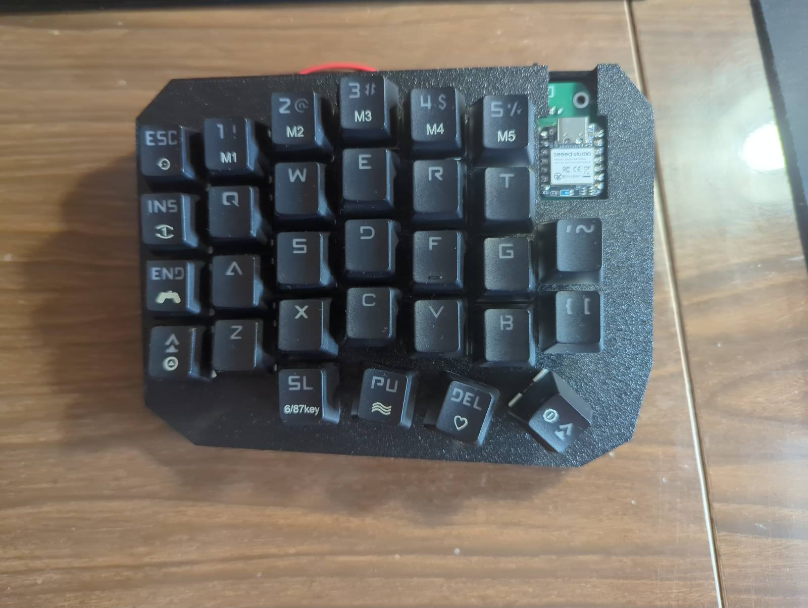
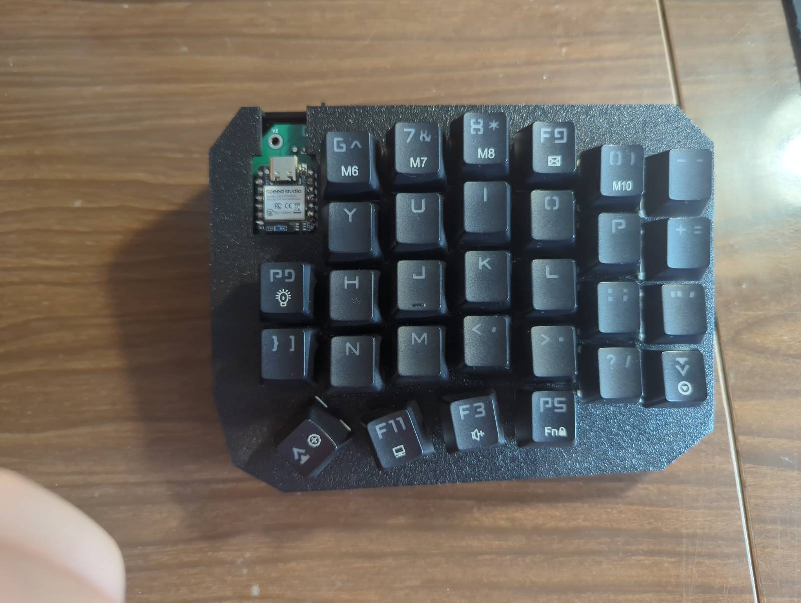
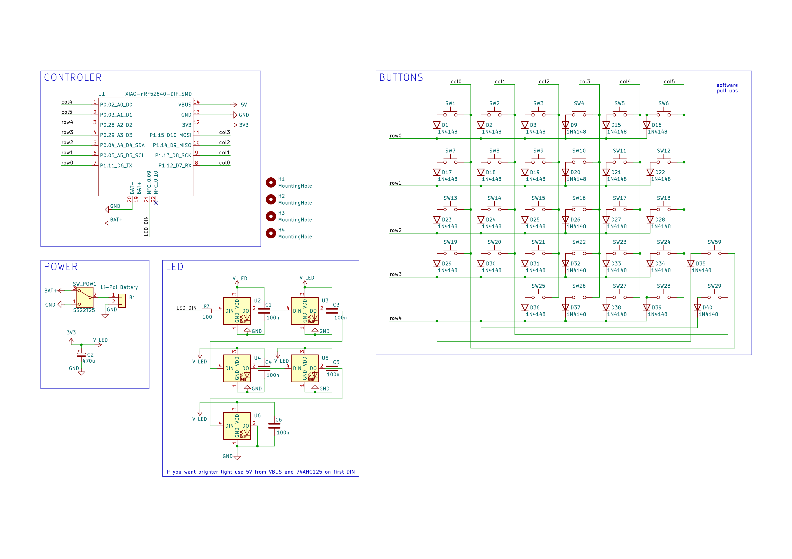
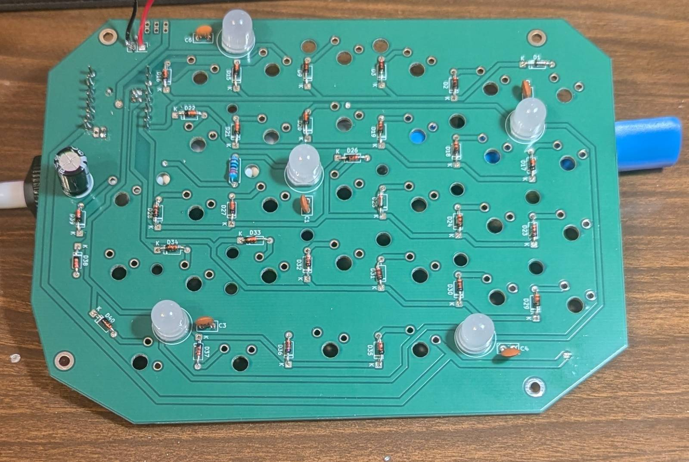
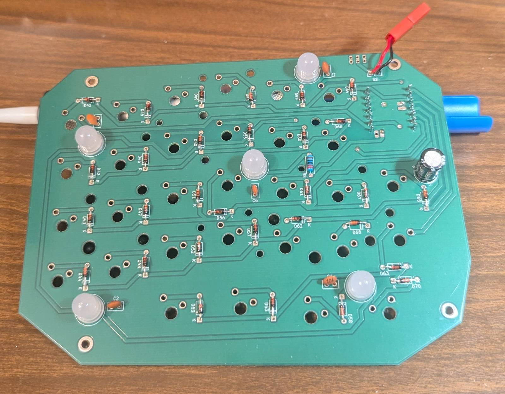

# split-keyboard
Split keyboard with ble and usb. Custom pcb based on nrf52840 mcu module with specific firmware written in  C (Zephyr)

# Firmware
All the firmware is stored in `software` directory. It also contains all the configs for Zephyr, Kconfig, CMAKE, scripts etc.
The source code is stored in `software/src`.

The right side connects to the left one using Bluetooth. It sends the hid codes of clicked keys with approximately 12 ms intervals.
The left side takes together keys clicked on left and right side and sends it to the PC using eithter Bluetooth or USB.
USB and Bluetooth are automatically switched. If the USB connection is detected it is a chosen communication method. If there is no USB connection then left side starts Bluetooth advertising or automatically connects to the PC if there is bonding already.

The name of the device is automatically WGRL_KEYBOARD, but you can change it in `software/config/prj_left.conf` in the `# Names` section.  

# Tools
All the important tools used in software development are listed in [version.info](version.info). 
The most important thing here is the Zephyr and west version.

# Compilation
To program the mcu you use eithter
`./scripts/run.sh left` or `./scripts/run.sh right` 
depending on the side

# Layout
The layout is compiled into the firmware. To change it you edit two source
files, rebuild, and flash. There are no layers and no runtime remapping.

[src/bus/bus.c](software/src/bus/bus.c) - which key code each switch sends

[src/matrix/matrix.c](software/src/bus/bus.c) - which switches act as modifiers (Ctrl, Shift, Alt...)

# LEDs
The LEDs color changes when any key with hid-code `0x00` is clicked (according to your #Layout).
The left side also will always turn white when CAPS_LOCK is activated.
Colors are set separately for each side.
The cycle is black -> red -> green -> blue -> black. It changes once per press.

# Electronics
The files for printed PCBs are stored in `hardware` directory.

This is for personal use so note that the boards don't have any ESD, reverse polarity, overvoltage protection etc.
Also it lacks extra capacitor to sustain battery voltage.

# PCB
Printed PCBs. The files are in `hardware` directory. They are based on only THT elements for easier soldering.

# Case
Case for left and right side are stored in `/case` directory. Right side is 3mm higher, because of LEDs placement.
