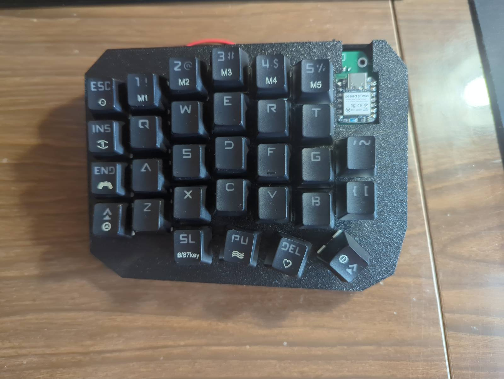
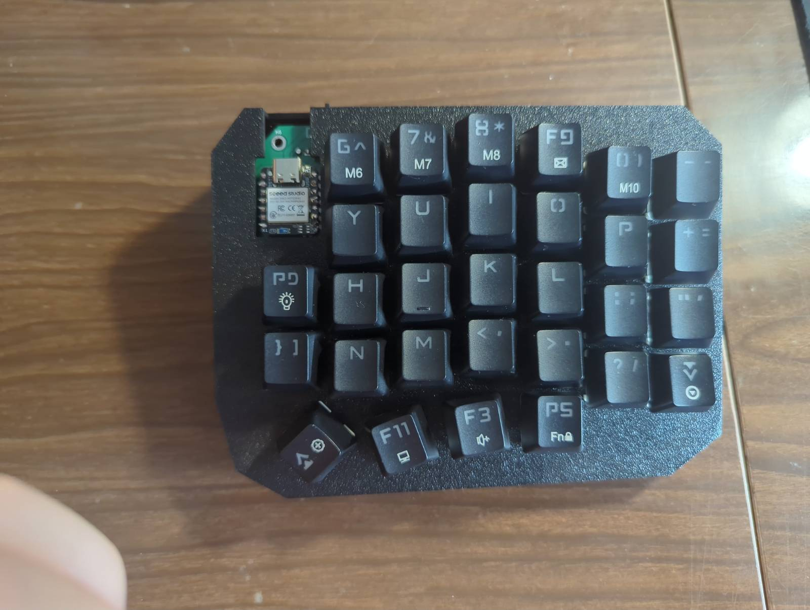
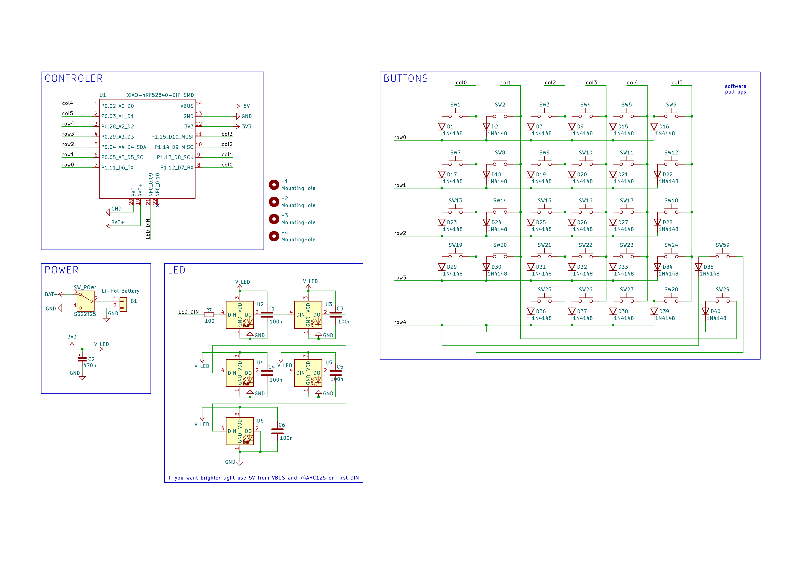
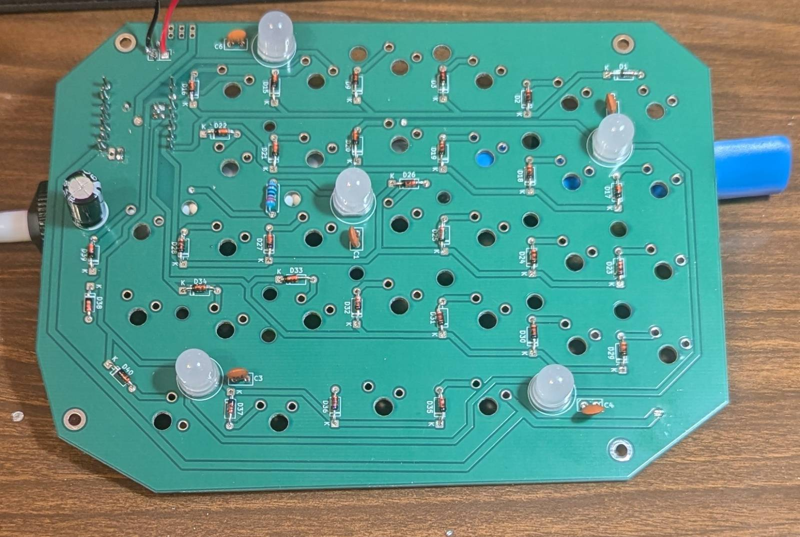
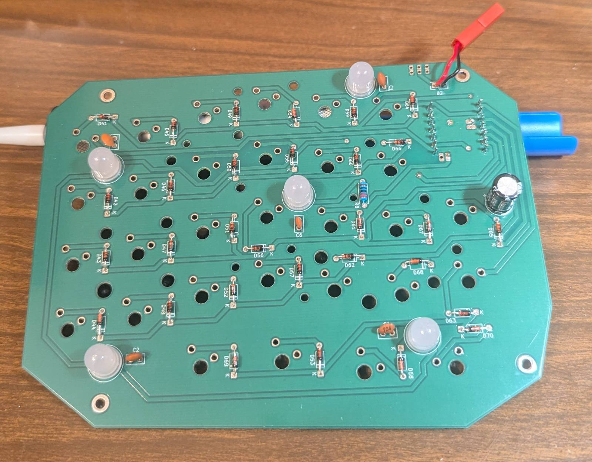

# split-keyboard
Split keyboard with ble and usb. Custom pcb based on nrf52840 mcu module with specific firmware written in  C (Zephyr)

# Firmware
All the firmware is stored in `software` directory. It also contains all the configs for Zephyr, Kconfig, CMAKE, scripts etc.
The source code is stored in `software/src`.

The right side connects to the left one using Bluetooth. It sends the hid codes of clicked keys with approximately 12 ms intervals.
The left side takes together keys clicked on left and right side and sends it to the PC using eithter Bluetooth or USB.
USB and Bluetooth are automatically switched. If the USB connection is detected it is a chosen communication method. If there is no USB connection then left side starts Bluetooth advertising or automatically connects to the PC if there is bonding already.

The name of the device is automatically WGRL_KEYBOARD, but you can change it in `software/config/prj_left.conf` in the `# Names` section.  

# Compilation
To program the mcu you use eithter
`./scripts/run.sh left` or `./scripts/run.sh right` 
depending on the side

# Electronics
The files for printed PCBs are stored in `hardware_printed` directory. I'll also put upgraded version in `hardware_enhanced` directory.

# PCB
Printed PCBs. The files are in `hardware_printed` directory. They are based on only THT elements for easier soldering.

